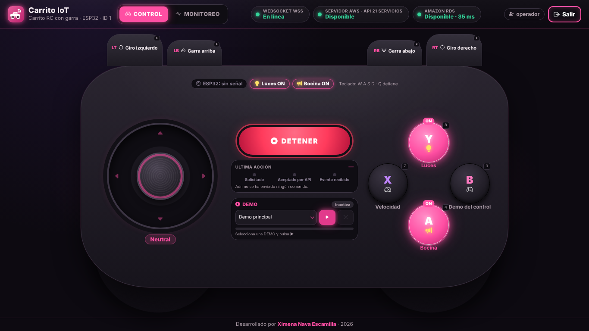
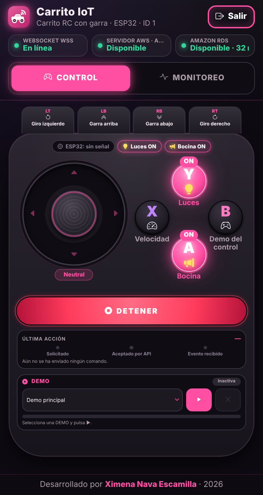
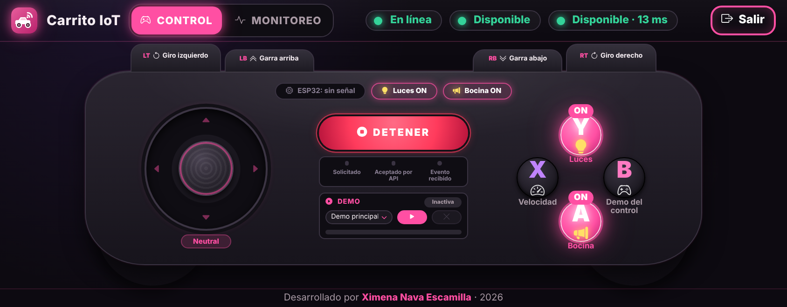
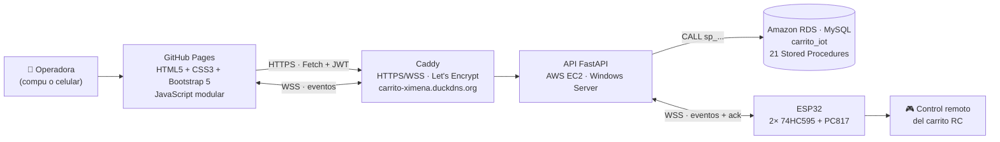
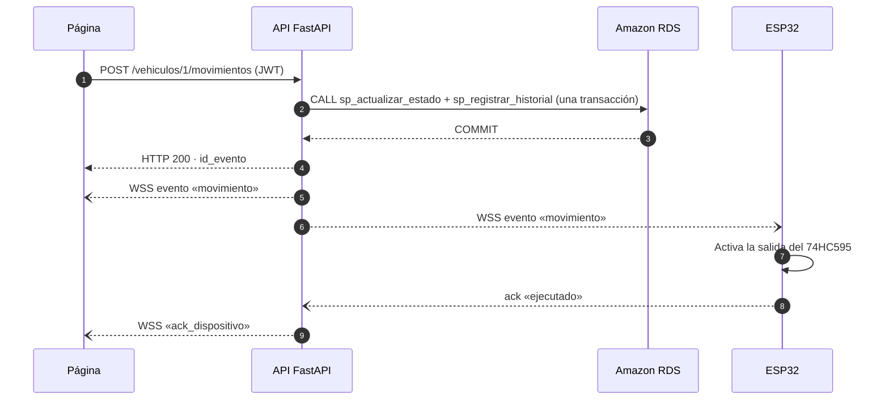

# 🎮 Carrito IoT · Aplicación de CONTROL

Aplicación web con diseño de **control tipo gamepad** (oscuro con brillos rosa neón) para manejar desde
el navegador un **carrito RC con garra** controlado por un **ESP32**. Cada botón llama a una
**API FastAPI en AWS**, que guarda la orden en **Amazon RDS** con Stored Procedures y la envía en tiempo
real al carrito por **WebSocket seguro (WSS)**.

| | |
|---|---|
| 🌐 **Sitio publicado** | https://ximena1906.github.io/carrito-iot-control/ |
| 📘 **API (Swagger UI)** | https://carrito-ximena.duckdns.org/docs |
| 🗂️ **Repositorio de la API** | https://github.com/Ximena1906/carrito-iot-api |
| 👩‍💻 **Desarrollado por** | Ximena Nava Escamilla |

---

## Contenido
1. [Capturas](#1-capturas)
2. [Arquitectura](#2-arquitectura)
3. [Cómo usar la aplicación](#3-cómo-usar-la-aplicación)
4. [Mapa de controles](#4-mapa-de-controles)
5. [Cómo viaja un comando](#5-cómo-viaja-un-comando)
6. [Indicadores de conexión](#6-indicadores-de-conexión)
7. [DEMO](#7-demo)
8. [Luces y bocina (ON/OFF)](#8-luces-y-bocina-onoff)
9. [Diseño estático y responsivo](#9-diseño-estático-y-responsivo)
10. [Tecnologías](#10-tecnologías)
11. [Estructura del proyecto](#11-estructura-del-proyecto)
12. [Seguridad](#12-seguridad)
13. [Ejecución local](#13-ejecución-local)
14. [Publicación en GitHub Pages](#14-publicación-en-github-pages)
15. [Pruebas realizadas](#15-pruebas-realizadas)
16. [Solución de problemas](#16-solución-de-problemas)

---

## 1. Capturas

**Computadora**



| Celular (vertical) | Celular (horizontal) |
|---|---|
|  |  |

---

## 2. Arquitectura



- La página **nunca** se conecta a la base de datos: todo pasa por la API.
- La API solo usa **Stored Procedures** (el usuario `api_carrito` tiene únicamente permiso `EXECUTE`).
- El ESP32 "presiona" los botones del control remoto del carrito a través de los optoacopladores PC817.

---

## 3. Cómo usar la aplicación

1. Abre el sitio. Los tres indicadores de arriba deben ponerse en **verde**.
2. Presiona **Iniciar sesión** y entra con la cuenta de **operador**. Sin sesión, los controles se ven
   bloqueados y aparece el aviso *«Inicia sesión como operador para controlar el carrito»*.
3. Revisa el chip **ESP32**: si dice **conectado**, el carrito físico recibirá las órdenes.
4. Usa el joystick, los gatillos, los botones A B X Y o el teclado.
5. Para parar todo en cualquier momento: botón rojo **DETENER** o tecla **Q**.
6. Al terminar, presiona **Salir**. El token se borra también al cerrar la pestaña.

---

## 4. Mapa de controles

Los botones se generan con el **catálogo real** de la API (`GET /vehiculos/1/comandos`): si un comando
no existe o está inactivo, su botón no aparece.

| Control en pantalla | Comando | Código | Tipo | Tecla |
|---|---|:---:|---|:---:|
| Joystick ↑ | `AVANZAR` | 1 | Mantener | W |
| Joystick ↓ | `RETROCEDER` | 2 | Mantener | S |
| Joystick ← | `MOVER_IZQUIERDA` | 7 | Mantener | A |
| Joystick → | `MOVER_DERECHA` | 8 | Mantener | D |
| **LT** · Giro izquierdo | `GIRAR_IZQUIERDA` | 3 | Mantener | 5 |
| **RT** · Giro derecho | `GIRAR_DERECHA` | 4 | Mantener | 6 |
| **LB** · Garra arriba | `SUBIR_BRAZO` | 5 | Mantener | 1 |
| **RB** · Garra abajo | `BAJAR_BRAZO` | 6 | Mantener | 2 |
| **Y** · Luces | `LUCES` | 10 | Un toque (ON/OFF) | 8 |
| **A** · Bocina | `BOCINA` | 11 | Un toque (ON/OFF) | 4 |
| **X** · Velocidad | `VELOCIDAD` | 12 | Un toque | 7 |
| **B** · Demo del control | `DEMO_CONTROL` | 13 | Un toque | 3 |
| **DETENER** | `DETENER` | 9 | Inmediato | Q |

- **Mantener:** el movimiento dura mientras mantienes presionado. La página lo envía con 10 s de
  duración máxima y lo renueva cada 8 s; al soltar envía `DETENER`.
- **Un toque:** el ESP32 presiona el botón del control remoto durante 150 ms.
- **Joystick:** tiene zona neutral e histéresis, y envía **un solo POST por cambio de dirección**
  (no uno por cada píxel que se mueve el dedo).
- **DETENER** tiene prioridad máxima: reemplaza cualquier orden pendiente y, si hay una DEMO en curso,
  la cancela.
- *«Demo del control» (B)* es la rutina de fábrica del juguete; es distinta de la **DEMO almacenada**
  (sección 7).

---

## 5. Cómo viaja un comando



El recuadro **Última acción** muestra las tres etapas de cada orden:

| Etapa | Significa |
|---|---|
| **Solicitado** | La página envió la orden a la API. |
| **Aceptado por API** | La API respondió HTTP 200 y la guardó en RDS. |
| **Evento recibido** | Llegó por WebSocket el evento con el mismo `id_evento`. |

> Ninguna etapa comprueba que los motores se movieron: confirman que la orden llegó y se publicó.

---

## 6. Indicadores de conexión

| Indicador | Cómo se comprueba | Estados |
|---|---|---|
| **WebSocket WSS** | Sesión WebSocket real del navegador, con latido *ping/pong* | 🟢 En línea · 🟡 Conectando / Reconectando · 🔴 Desconectado |
| **Servidor AWS · API 21 servicios** | `GET /health` cada 15 s | 🟢 Disponible · 🟡 Comprobando · 🔴 No disponible |
| **Amazon RDS** | `GET /health/db` cada 30 s (muestra la latencia) | 🟢 Disponible · 🔴 No disponible · ⚪ Sin verificar |
| **Chip ESP32** | Evento `dispositivo` del WebSocket | 🟢 conectado · ⚪ sin señal |

*«En línea»* indica la conexión **de este navegador** con el servidor; no confirma por sí solo que el
carrito físico esté conectado (para eso está el chip **ESP32**). Si se pierde la conexión, el WebSocket
se reconecta solo, con espera exponencial de 1 s hasta 15 s.

---

## 7. DEMO

La **DEMO almacenada** («Demo principal») está guardada en RDS y la ejecuta el **servidor**, no la página.

| Paso | Movimiento | Duración |
|:---:|---|---|
| 1 | Avanzar | 2 s |
| 2 | Retroceder | 2 s |
| 3 | Girar a la izquierda | 1 s |
| 4 | Girar a la derecha | 1 s |
| 5 | Desplazarse a la izquierda | 1.2 s |
| 6 | Desplazarse a la derecha | 1.2 s |
| 7 | Garra arriba | 1.5 s |
| 8 | Garra abajo | 1.5 s |

- **▶** inicia (`POST /vehiculos/1/demos/{id}/iniciar`) y **✕** cancela (`POST /vehiculos/1/demos/cancelar`).
- El avance se muestra con los eventos `demo_inicio`, `demo_paso`, `demo_fin` o `demo_cancelada`.
- Mientras corre, los demás controles se bloquean; **DETENER** sigue funcionando y cancela la DEMO.

---

## 8. Luces y bocina (ON/OFF)

El carrito **arranca con las luces y la bocina encendidas**, y cada toque de su botón en el control
remoto cambia al estado contrario. El control **no informa** su estado real, así que la página lleva
la cuenta:

- Los botones **Y** (luces) y **A** (bocina) se ven **prendidos** (rosa neón, etiqueta **ON**) o
  **apagados** (oscuros, etiqueta **OFF**).
- Arriba del control, los letreros **Luces ON/OFF** y **Bocina ON/OFF** muestran lo mismo (solo informan).
- Empiezan en **ON** y cambian cada vez que la API acepta el comando (evento `movimiento`).
- Si la página está abierta en varios dispositivos, todos cambian a la vez.
- Al recargar la página vuelven a **ON**. Si se desfasan (por ejemplo, porque se usó el control
  físico), recarga la página con el carrito recién encendido.

---

## 9. Diseño estático y responsivo

- La página **no se desplaza**: todo el control cabe en una sola pantalla, como una app.
- Todo el gamepad se escala con una sola unidad CSS (`--u`) calculada con *container queries*, según el
  espacio disponible a lo ancho y a lo alto.
- **Computadora y celular acostado:** gamepad horizontal con empuñaduras.
- **Celular vertical:** gatillos arriba, joystick y A B X Y en medio, DETENER y DEMO abajo.
- En celulares se evita que un botón se quede "iluminado" después de tocarlo (`@media (hover: hover)`).

---

## 10. Tecnologías

| Capa | Tecnología |
|---|---|
| Estructura | HTML5 semántico, accesible (roles ARIA, foco visible, `aria-live`) |
| Estilos | CSS3 (variables, grid, container queries) + Bootstrap 5.3.3 + Bootstrap Icons 1.11.3 (con SRI) |
| Lógica | JavaScript ES Modules, sin frameworks: Fetch + `async/await`, WebSocket nativo, Pointer Events |
| Publicación | GitHub Pages |
| Backend | FastAPI (Python) en AWS EC2 · Caddy · Amazon RDS MySQL |

---

## 11. Estructura del proyecto

```
carrito-iot-control/
├── index.html                   # Estructura de la página (encabezado, gamepad, diálogo de sesión)
├── README.md
├── docs/capturas/               # Imágenes de este README
└── assets/
    ├── css/estilos.css          # Gamepad oscuro rosa neón, sin scroll en celular y escritorio
    ├── img/                     # Favicon propio (SVG + PNG + apple-touch-icon)
    └── js/
        ├── app.js               # Arranque y enlace de vistas (sin reglas de negocio)
        ├── config.js            # URL de la API, WSS, vehículo, rutas y presentación (sin secretos)
        ├── estado.js            # Estado de la aplicación con suscripciones
        ├── api/cliente.js       # Cliente REST: Fetch, timeout, errores HTTP y JSON
        ├── api/websocket.js     # Sesión WSS: reconexión exponencial y latido ping/pong
        ├── control/comandos.js  # Coordinador ÚNICO de comandos (cola, prioridad de DETENER)
        ├── control/joystick.js  # Joystick táctil, mouse y flechas del teclado
        ├── control/botones.js   # Botones del catálogo y su lugar en el gamepad
        ├── control/teclado.js   # Atajos W A S D / Q / 1–8
        ├── demo/demos.js        # Selección, inicio, cancelación y progreso de la DEMO
        ├── ui/indicadores.js    # Indicadores de WebSocket, servidor AWS y RDS
        ├── ui/sesion.js         # Inicio y cierre de sesión del operador
        ├── ui/mensajes.js       # Avisos breves (toast)
        ├── ui/accesorios.js     # Luces y bocina prendidas/apagadas (ON/OFF)
        └── utils/               # dom.js (inserción segura), errores.js
```

---

## 12. Seguridad

- **Sin secretos en el repositorio.** La contraseña del operador se escribe en el formulario; el token
  JWT de corta duración vive solo en `sessionStorage` y se descarta al cerrar la pestaña o ante un 401.
- **Todo el tráfico va por HTTPS/WSS** (sin contenido mixto). El backend solo acepta por CORS los
  orígenes autorizados; CORS no es autenticación: cada acción exige el token.
- **Sin inyección de HTML:** los datos de la API se insertan con `textContent`, nunca con `innerHTML`.
- **Sin acceso directo a la base de datos** desde el navegador: RDS solo se verifica con `GET /health/db`.
- Las librerías del CDN se cargan con **Subresource Integrity (SRI)**.

---

## 13. Ejecución local

1. Abre la carpeta en VS Code y usa la extensión **Live Server** (puerto 5500), o ejecuta
   `python -m http.server 5500` y visita `http://127.0.0.1:5500`.
2. Para usar una API local, cambia `API_BASE_URL` y `WS_BASE_URL` en `assets/js/config.js`
   (por ejemplo `http://127.0.0.1:8000` y `ws://127.0.0.1:8000`).
3. El backend debe permitir el origen `http://127.0.0.1:5500` en `CORS_ORIGENES` de su `.env`.

---

## 14. Publicación en GitHub Pages

1. *Settings → Pages → Source: Deploy from a branch → `main` / `(root)`*.
2. Cada `git push` a `main` lanza **pages build and deployment** en la pestaña **Actions**; cuando queda
   con palomita verde, el sitio ya está actualizado.
3. Todas las rutas son relativas, por lo que funcionan en la subruta `/carrito-iot-control/`.
4. El archivo `.nojekyll` evita que GitHub procese el sitio con Jekyll.

---

## 15. Pruebas realizadas

Pruebas automáticas en navegador (Chrome) contra la API:

- **Funcionamiento (28 pruebas):** indicadores, catálogo de botones, inicio de sesión correcto e
  incorrecto, token solo en `sessionStorage`, joystick (un POST por dirección y `DETENER` al soltar),
  ráfagas rápidas sin órdenes duplicadas, botones de mantener y de un toque, teclado, DEMO
  (inicio, pasos, cancelación y `DETENER`) y recuperación tras una caída de la API.
- **Luces y bocina (10 pruebas):** inicio en ON, cambio con Y, A y tecla 8, letreros sincronizados,
  sincronización entre pestañas y regreso a ON al recargar.
- **Diseño:** sin desplazamiento y con todos los botones visibles y tocables en computadora
  (1920×960, 1366×768, 1280×640), tablet (820×1100), iPhone 14, iPhone SE, Android y celular horizontal.
- **Verificación independiente del WebSocket:** con un cliente externo (Thunder Client, Postman o una
  extensión de VS Code/Chrome) conectado a `wss://carrito-ximena.duckdns.org/ws/vehiculos/1`, cada acción
  de la página produce un evento `movimiento` con `id_vehiculo`, `comando`, `codigo`, `id_evento` y
  `timestamp`; la DEMO produce `demo_inicio`, 8 × `demo_paso` y `demo_fin` o `demo_cancelada`.

---

## 16. Solución de problemas

| Síntoma | Causa probable | Qué hacer |
|---|---|---|
| Los indicadores dicen **No disponible** y la página de `/health` muestra *FortiGuard … Dynamic DNS* | La red (escuela o trabajo) bloquea los dominios de DuckDNS | Usa datos móviles o comparte internet desde el celular |
| **No disponible** en cualquier red | La sesión del Learner Lab terminó y EC2 se apagó | *Start Lab*, inicia la instancia **Server2** y revisa que RDS esté *Disponible*; la IP elástica y los servicios arrancan solos |
| Se sigue viendo el diseño anterior | Caché del navegador o publicación pendiente | Revisa **Actions** (palomita verde) y abre la página en incógnito o con **Ctrl+Shift+R** |
| *pages build and deployment* con X roja o *Startup failure* | Falla temporal de GitHub | Revisa https://www.githubstatus.com y usa **Re-run all jobs** cuando se recupere |
| Chip **ESP32: sin señal** | El carrito está apagado o en una red que bloquea DuckDNS | Enciende el carrito y conéctalo al punto de acceso del celular |
| «La sesión expiró» | El token JWT caducó | Vuelve a iniciar sesión |

---

<p align="center">Desarrollado por <b>Ximena Nava Escamilla</b> · 2026</p>
